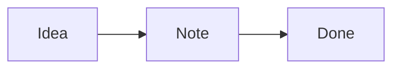

# Write and format

#getting started#

You want notes that are quick to write and easy to read later. This note shows the few marks that do it.

Theo Notes saves as you type. The first line is the title of the note, and everything is plain Markdown text that any other app can read.

## Headings and styles

Start a line with `#` and a space to make a heading. Two hashes make a smaller one.

| You type | You get |
|---|---|
| `**bold**` | **bold** |
| `_italic_` | _italic_ |
| `~underline~` | ~underline~ |
| `~~strikethrough~~` | ~~strikethrough~~ |
| `==highlight==` | ==highlight== |

On the Mac, the formatting bar at the bottom of the note has buttons for headings, to-dos, lists, bold, italic, highlight, links, tables and files. **View ▸ Hide Formatting Bar** (⇧⌘Y) puts it away.

By default the marks fade away while you read and come back when the cursor is next to them. You can show them all the time with Hide Markdown in Settings ▸ General.

## Lists and to-dos

- A line that starts with `-` is a bullet
- Press Return twice to end the list
- Press Tab to indent an item. On iPhone and iPad, open Formatting in the bar at the bottom of the note and choose Indent

1. Numbered lists count for you
2. Like this

A line that starts with `- [ ]` is a to-do with a box you can tap or click. A finished one looks like this:

- [x] Write a note

Settings ▸ General has a switch that keeps finished to-dos at the bottom of their list.

## Quotes and callouts

> A quote starts with a `>`.

> [!TIP] A callout
> Start a quote with `[!NOTE]`, `[!TIP]`, `[!IMPORTANT]`, `[!WARNING]` or `[!CAUTION]` to make it stand out.

## Code, tables and math

Fence code with three backticks. Add the language after them to get colors.

```swift
let greeting = "Hello, Theo Notes"
print(greeting)
```

Tables are written with bars, like the one above. Math goes between dollar signs: $a^2 + b^2 = c^2$.

A code block named `mermaid` turns into a diagram:



## Pictures and files

On the Mac, drag a picture, a PDF or any other file into a note, or paste it. On iPhone and iPad, paste it, or tap Attach in the bar at the bottom of the note and choose Photo Library, Insert File, Scan Document or New Sketch. The camera button next to it takes a photo straight into the note. The file is kept with the note.

## Everything else

The Format menu on the Mac and the Formatting button on iPhone and iPad list the formatting commands, so there is nothing to memorize.

Back to the start: [[Welcome to Theo Notes]].
