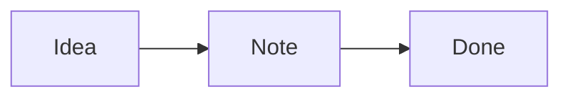

# Write and format

#getting started#

Theo Notes saves as you type. The first line is the title of the note, and everything is plain Markdown text that any other app can read.

## Headings and styles

Start a line with `#` and a space to make a heading. Two hashes make a smaller one.

| You type | You get |
|---|---|
| `**bold**` | **bold** |
| `_italic_` | _italic_ |
| `~underline~` | ~underline~ |
| `~~strikethrough~~` | ~~strikethrough~~ |
| `==highlight==` | ==highlight== |

By default the marks fade away while you read and come back when the cursor is next to them. You can show them all the time with Hide Markdown in Settings ▸ General.

## Lists and to-dos

- A line that starts with `-` is a bullet
- Press Return twice to end the list
- Press Tab to indent an item

1. Numbered lists count for you
2. Like this

A line that starts with `- [ ]` is a to-do with a box you can click. A finished one looks like this:

- [x] Write a note

Settings ▸ General can move finished to-dos to the bottom of their list.

## Quotes and callouts

> A quote starts with a `>`.

> [!TIP] A callout
> Start a quote with `[!NOTE]`, `[!TIP]`, `[!IMPORTANT]`, `[!WARNING]` or `[!CAUTION]` to make it stand out.

## Code, tables and math

Fence code with three backticks. Add the language after them to get colors.

```swift
let greeting = "Hello, Theo Notes"
print(greeting)
```

Tables are written with bars, like the one above. Math goes between dollar signs: $a^2 + b^2 = c^2$.

A code block named `mermaid` turns into a diagram:



## Pictures and files

Drag a picture, a PDF or any other file into a note, or paste it. The file is kept with the note.

## Everything else

The Format menu lists every formatting command with its shortcut, so there is nothing to memorize. Next: [[Tags and links]].
