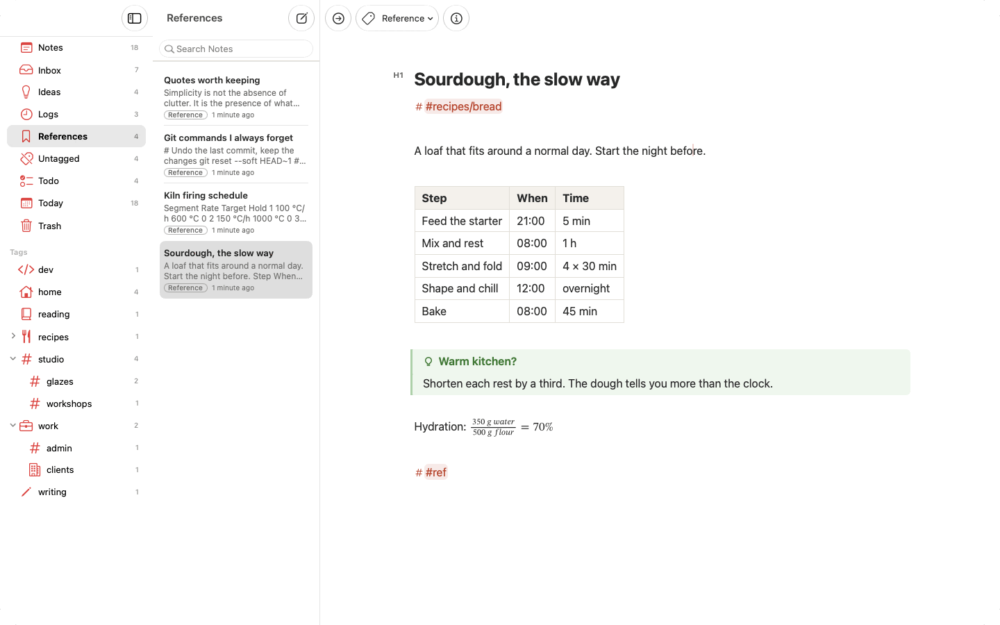

<p align="center">
  
</p>

<h1 align="center">Theo Notes</h1>

<p align="center">
  Markdown notes for Mac, iPhone, iPad and Apple Watch.<br>
  Plain text you own, tags and links, fast search, iCloud sync, and a command line tool your AI assistant can use.
</p>

<p align="center">
  <a href="https://apps.apple.com/app/id6832478875">App Store (iPhone, iPad, Apple Watch)</a> ·
  <a href="https://theonotes.app/download">Download for Mac</a> ·
  <a href="https://theonotes.app">theonotes.app</a>
</p>

<p align="center">
  
</p>

## What it is

Theo Notes is a notes app that stores every note as Markdown, exactly as you typed it.

- **Write in Markdown** with headings, lists, to-dos, tables, callouts, code blocks, math and diagrams. The formatting marks stay out of your way while you write.
- **Organise with tags**, including nested tags such as `#work/clients`, and link notes to each other.
- **Find anything**: full-text search over all notes, including text in images and scanned PDFs.
- **Lock notes** with a password (Touch ID and Face ID where available).
- **Sync through your own iCloud account** between Mac, iPhone and iPad.
- **Capture fast**: share sheets, widgets, Shortcuts, and a Watch app for dictated notes.
- **Bring your notes**: import from Apple Notes, Evernote, Notion, Bear, Markdown files and ZIP archives; export to Markdown, HTML, PDF and full backups.
- **Use it with Claude and other AI tools**: the `theonotes` command line tool reads, searches and writes your notes, and `theonotes mcp-server` offers the same as an MCP server.

<p align="center">
  
  
</p>
<p align="center">
  
</p>

## Get the app

| Platform | Where | Needs |
|---|---|---|
| Mac | [theonotes.app/download](https://theonotes.app/download) (free, notarized) | macOS 26 or later |
| iPhone and iPad | [App Store](https://apps.apple.com/app/id6832478875) (free) | iOS / iPadOS 26 or later |
| Apple Watch | installs with the iPhone app | watchOS 26 or later |

## Build from source

You need a Mac with macOS 26 and Xcode 26 or later, [XcodeGen](https://github.com/yonaskolb/XcodeGen), Node.js with [pnpm](https://pnpm.io), and Python 3.

```sh
scripts/bootstrap.sh   # installs the editor's JS packages and a Playwright browser, generates TheoNotes.xcodeproj
scripts/build.sh       # builds the editor bundle and the Mac app (development identity)
scripts/test-all.sh    # Swift tests, editor tests, browser tests, Python tests and the repository guards
```

The app lands in `build/DerivedData/Build/Products/Debug/`. The development build is called "Theo Notes Dev" and keeps its library in its own folder (`~/Library/Application Support/Theo Notes Dev`), so it never touches the notes of an installed copy.

The Xcode project is generated from `project.yml` and is not committed. Signing uses the team in `config/release.env`; without that team, build unsigned:

```sh
xcodebuild -project TheoNotes.xcodeproj -scheme TheoNotes -configuration Debug \
  -derivedDataPath build/DerivedData CODE_SIGNING_ALLOWED=NO build
```

If you want to ship your own build, change the bundle id root in `config/identity.env`, the team in `config/release.env`, and the name and icon (see [Trademark](#trademark)).

How the code is organised: [docs/ARCHITECTURE.md](docs/ARCHITECTURE.md).

## Licence

Theo Notes is free software: you can redistribute it and modify it under the terms of the [GNU General Public License, version 3 only](LICENSE) (`GPL-3.0-only`). Third-party components keep their own licences; see [NOTICE](NOTICE) and the Acknowledgements window in the app.

## Trademark

The name "Theo Notes", the logo and the app icon are trademarks of True Brew Birdie Ltd. and are **not** covered by the GPL. Read [TRADEMARK.md](TRADEMARK.md) and [BRANDING.md](BRANDING.md) before you distribute a modified version.

Bear, Evernote, Notion and Apple Notes are trademarks of their respective owners. Theo Notes is not affiliated with them; their names appear only to describe what Theo Notes can import.

## Contributing

Bug reports and pull requests are welcome. Before your first pull request can be merged, please sign the [Contributor Licence Agreement](CLA.md); you keep your copyright. [CONTRIBUTING.md](CONTRIBUTING.md) explains the build, the commit style and the clean-room rules, and the [Code of Conduct](CODE_OF_CONDUCT.md) applies everywhere in the project.

## Security

Please do not open a public issue for a security problem. Write to hello@theonotes.app; details in [SECURITY.md](SECURITY.md).
