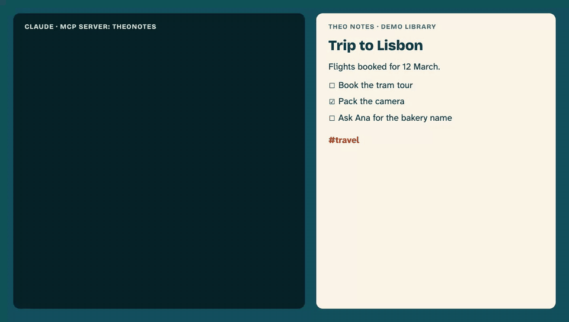
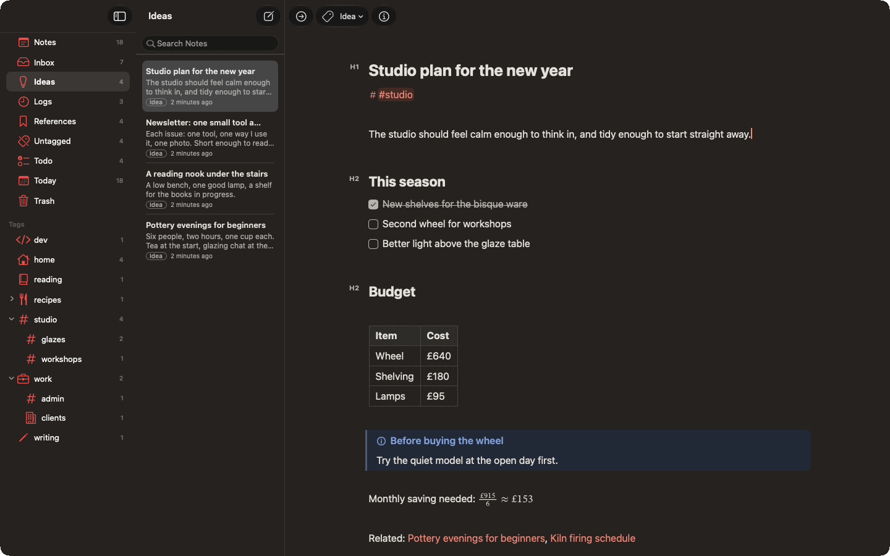
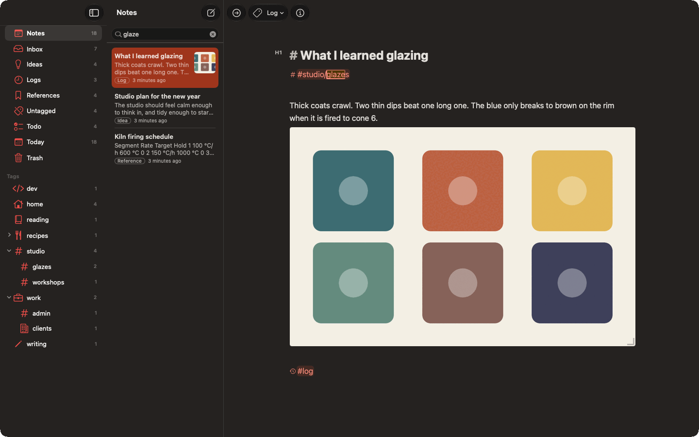
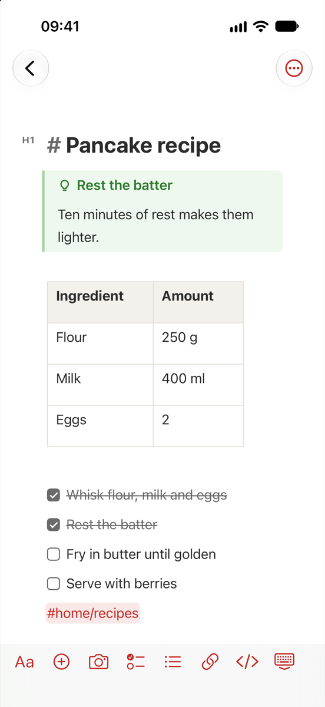

<p align="center">
  
</p>

<h1 align="center">Theo Notes</h1>

<p align="center">
  <strong>Open-source alternative to Apple Notes and Obsidian: Markdown notes for Mac, iPhone, iPad and Apple Watch, with an MCP server for Claude.</strong>
</p>

<p align="center">
  <a href="https://apps.apple.com/app/id6832478875"></a>
  <a href="../../releases/latest"></a>
  <a href="LICENSE"></a>
  
  <a href="#use-with-claude"></a>
</p>

<p align="center">
  <a href="https://apps.apple.com/app/id6832478875">App Store (iPhone, iPad, Apple Watch)</a> ·
  <a href="https://theonotes.app/download">Download for Mac</a> ·
  <a href="https://theonotes.app">theonotes.app</a> ·
  <a href="docs/readme/README_de.md">Deutsch</a>
</p>

<p align="center">
  
</p>

## What it is

Theo Notes is a notes app that stores every note as Markdown, exactly as you typed it.

- **Write in Markdown** with headings, lists, to-dos, tables, callouts, code blocks, math and diagrams. The formatting marks stay out of your way while you write.
- **Organise with tags**, including nested tags such as `#work/clients`, and link notes to each other.
- **Find anything**: full-text search over all notes, including text in images and scanned PDFs.
- **Lock notes** with a password (Touch ID and Face ID where available).
- **Sync through your own iCloud account** between Mac, iPhone and iPad.
- **Capture fast**: share sheets, widgets, Shortcuts, and a Watch app for dictated notes.
- **Bring your notes**: import from Apple Notes, Evernote, Notion, Bear, Markdown files and ZIP archives; export to Markdown, HTML, PDF and full backups.
- **Use it with Claude and other AI tools**: the `theonotes` command line tool reads, searches and writes your notes, and `theonotes mcp-server` offers the same as an MCP server.

<p align="center">
  
  
</p>
<p align="center">
  
</p>

## Use with Claude

The Mac app ships an MCP server, `theonotes mcp-server`, that serves your library to Claude over stdio. It runs on your Mac and reads the library there; nothing goes to a server of ours.

**Claude Desktop (one click):** install the Mac app (1.2 or later) and open it once, then open **Settings → Automation** and click **Connect to Claude**. Claude shows its own install dialog; click **Install**. It asks for optional **Only tags** / **Exclude tags** to limit which notes Claude sees.

**Claude Code:** add this repository as a plugin marketplace and install the plugin:

```text
/plugin marketplace add https://github.com/jankutschera/theonotes
/plugin install theonotes@theonotes
```

The plugin starts the server inside the installed app, so it updates with the app. Its tag limits are under `/config`.

Then ask Claude something like "What is still open in my trip note?".

The server reads and writes the library directly, so the app does not need to be running. App Lock does not apply to it.

**Other ways:** **Settings → Automation → Other ways to connect** copies a `claude_desktop_config.json` entry or a `claude mcp add` command for Terminal, with `--only-tags` / `--exclude-tags` filled in from its fields. Other MCP clients start `theonotes mcp-server` the same way (click **Install in ~/.local/bin** first to get the short path `~/.local/bin/theonotes`).

### Without the app

There is no separate download of `theonotes` yet. You can build it from this repository with Swift alone:

```sh
cd Packages/TheoNotesCore
swift build -c release --product theonotes
.build/release/theonotes --help
```

It needs an existing Theo Notes library: it never creates one. By default it uses the library of the installed Mac app (`~/Library/Application Support/Theo Notes`); `--data-dir <path>` or `THEONOTES_DATA_DIR` points it at another one. A Homebrew formula will follow once there is demand for it.

## Showcases

What the MCP server is good at, with prompts you can try:

- **Find and act**: "What is still open for my Lisbon trip? Add 'Buy tram tickets'." (the clip above, recorded on a demo library)
- **Capture from a conversation**: "Save the plan we just made as a note tagged #work/clients."
- **Tidy up**: "List my notes tagged #inbox and suggest a tag for each."

Built something with it? Share it in [Show and tell](https://github.com/jankutschera/theonotes/discussions/categories/show-and-tell). Questions go to [Q&A](https://github.com/jankutschera/theonotes/discussions/categories/q-a).

## Get the app

| Platform | Where | Needs |
|---|---|---|
| Mac | [theonotes.app/download](https://theonotes.app/download) (free, notarized) | macOS 26 or later |
| iPhone and iPad | [App Store](https://apps.apple.com/app/id6832478875) (free) | iOS / iPadOS 26 or later |
| Apple Watch | installs with the iPhone app | watchOS 26 or later |

## Build from source

You need a Mac with macOS 26 or later and Xcode 27.2 (Swift 6.4), [XcodeGen](https://github.com/yonaskolb/XcodeGen), Node.js with [pnpm](https://pnpm.io), and Python 3.

```sh
scripts/bootstrap.sh   # installs the editor's JS packages and a Playwright browser, generates TheoNotes.xcodeproj
scripts/build.sh       # builds the editor bundle and the Mac app (development identity)
scripts/test-all.sh    # Swift tests, editor tests, browser tests, Python tests and the repository guards
```

The app lands in `build/DerivedData/Build/Products/Debug/`. The development build is called "Theo Notes Dev" and keeps its library in its own folder (`~/Library/Application Support/Theo Notes Dev`), so it never touches the notes of an installed copy.

The Xcode project is generated from `project.yml` and is not committed. Signing uses the team in `config/release.env`; without that team, build unsigned:

```sh
xcodebuild -project TheoNotes.xcodeproj -scheme TheoNotes -configuration Debug \
  -derivedDataPath build/DerivedData CODE_SIGNING_ALLOWED=NO build
```

If you want to ship your own build, change the bundle id root in `config/identity.env`, the team in `config/release.env`, and the name and icon (see [Trademark](#trademark)).

How the code is organised: [docs/ARCHITECTURE.md](docs/ARCHITECTURE.md).

## Licence

Theo Notes is free software: you can redistribute it and modify it under the terms of the [GNU General Public License, version 3 only](LICENSE) (`GPL-3.0-only`). Third-party components keep their own licences; see [NOTICE](NOTICE) and the Acknowledgements window in the app.

## Trademark

The name "Theo Notes", the logo and the app icon are trademarks of True Brew Birdie Ltd. and are **not** covered by the GPL. Read [TRADEMARK.md](TRADEMARK.md) and [BRANDING.md](BRANDING.md) before you distribute a modified version.

Bear, Evernote, Notion, Obsidian and Apple Notes are trademarks of their respective owners. Theo Notes is not affiliated with them; their names appear only to describe what Theo Notes can import or how it compares. Claude is a trademark of Anthropic; Theo Notes is not affiliated with Anthropic.

## Contributing

Bug reports and pull requests are welcome. Before your first pull request can be merged, please sign the [Contributor Licence Agreement](CLA.md); you keep your copyright. [CONTRIBUTING.md](CONTRIBUTING.md) explains the build, the commit style and the clean-room rules, and the [Code of Conduct](CODE_OF_CONDUCT.md) applies everywhere in the project.

## Security

Please do not open a public issue for a security problem. Write to hello@theonotes.app; details in [SECURITY.md](SECURITY.md).
