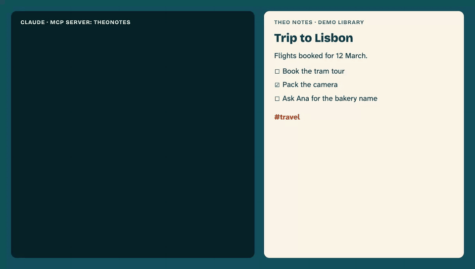

<p align="center">
  
</p>

<h1 align="center">Theo Notes</h1>

<p align="center">
  <strong>Open-Source-Alternative zu Apple Notizen und Obsidian: Markdown-Notizen für Mac, iPhone, iPad und Apple Watch, mit einem MCP-Server für Claude.</strong>
</p>

<p align="center">
  <a href="https://apps.apple.com/app/id6832478875">App Store (iPhone, iPad, Apple Watch)</a> ·
  <a href="https://theonotes.app/download">Download für den Mac</a> ·
  <a href="https://theonotes.app">theonotes.app</a> ·
  <a href="../../README.md">English</a>
</p>

<p align="center">
  
</p>

## Was es ist

Theo Notes ist eine Notiz-App, die jede Notiz als Markdown speichert, genau so, wie du sie getippt hast.

- **Schreiben in Markdown** mit Überschriften, Listen, To-dos, Tabellen, Callouts, Codeblöcken, Formeln und Diagrammen. Die Formatierungszeichen treten beim Schreiben in den Hintergrund.
- **Ordnen mit Tags**, auch verschachtelt wie `#arbeit/kunden`, und Notizen untereinander verlinken.
- **Alles finden**: Volltextsuche über alle Notizen, auch Text in Bildern und gescannten PDFs.
- **Notizen sperren** mit Passwort (Touch ID und Face ID, wo verfügbar).
- **Sync über dein eigenes iCloud-Konto** zwischen Mac, iPhone und iPad.
- **Schnell festhalten**: Teilen-Menü, Widgets, Kurzbefehle und eine Watch-App für diktierte Notizen.
- **Notizen mitnehmen**: Import aus Apple Notizen, Evernote, Notion, Bear, Markdown-Dateien und ZIP-Archiven; Export als Markdown, HTML, PDF und vollständiges Backup.
- **Mit Claude und anderen KI-Werkzeugen nutzen**: Das Kommandozeilenwerkzeug `theonotes` liest, durchsucht und schreibt deine Notizen, `theonotes mcp-server` bietet dasselbe als MCP-Server.

## Mit Claude nutzen

1. Installiere die Mac-App und öffne sie einmal, damit sie deine Bibliothek anlegt.
2. Öffne in der App **Settings → Automation** und klicke **Install in ~/.local/bin**.
3. Füge den Server in Claude Code hinzu:
   ```sh
   claude mcp add theonotes -- ~/.local/bin/theonotes mcp-server
   ```
4. Für Claude Desktop: **Copy Claude config** klicken und in `claude_desktop_config.json` einfügen.
5. Frag Claude zum Beispiel: „Was ist in meiner Reisenotiz noch offen?“ Mit `--only-tags arbeit` oder `--exclude-tags privat` nach `mcp-server` legst du fest, welche Notizen Claude sieht.

Der Server liest und schreibt die Bibliothek direkt; die App muss dafür nicht laufen. Die App-Sperre gilt für ihn nicht.

### Ohne die App

Einen eigenen Download von `theonotes` gibt es noch nicht. Du kannst es aus diesem Repository nur mit Swift bauen:

```sh
cd Packages/TheoNotesCore
swift build -c release --product theonotes
.build/release/theonotes --help
```

Es braucht eine bestehende Theo-Notes-Bibliothek und legt selbst keine an. Standardmäßig nutzt es die Bibliothek der installierten Mac-App; `--data-dir <pfad>` oder `THEONOTES_DATA_DIR` zeigt auf eine andere.

## App holen

| Plattform | Wo | Voraussetzung |
|---|---|---|
| Mac | [theonotes.app/download](https://theonotes.app/download) (kostenlos, notarisiert) | macOS 26 oder neuer |
| iPhone und iPad | [App Store](https://apps.apple.com/app/id6832478875) (kostenlos) | iOS / iPadOS 26 oder neuer |
| Apple Watch | wird mit der iPhone-App installiert | watchOS 26 oder neuer |

## Aus dem Quellcode bauen, Lizenz, Mitmachen

Bauanleitung, Lizenz (GPL-3.0-only), Markenhinweise und Regeln fürs Mitmachen stehen im [englischen README](../../README.md). Diese Übersetzung kann hinter dem englischen Original zurückliegen; im Zweifel gilt das Original.

Name, Logo und App-Symbol von „Theo Notes“ sind Marken der True Brew Birdie Ltd. und nicht von der GPL umfasst. Bear, Evernote, Notion, Obsidian und Apple Notizen sind Marken ihrer jeweiligen Inhaber; Theo Notes ist mit ihnen nicht verbunden. Claude ist eine Marke von Anthropic; Theo Notes ist mit Anthropic nicht verbunden.
